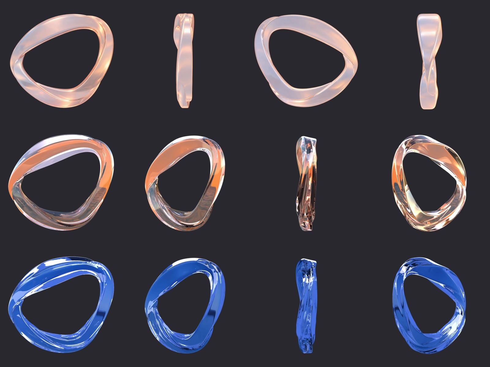
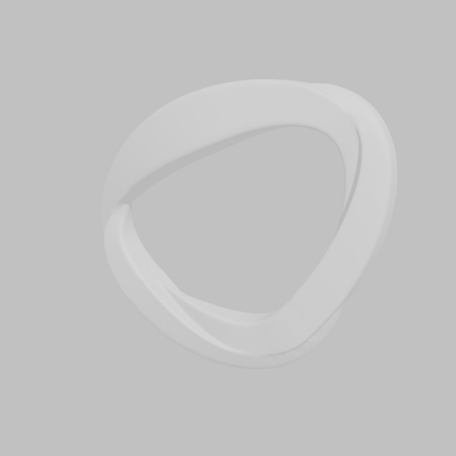
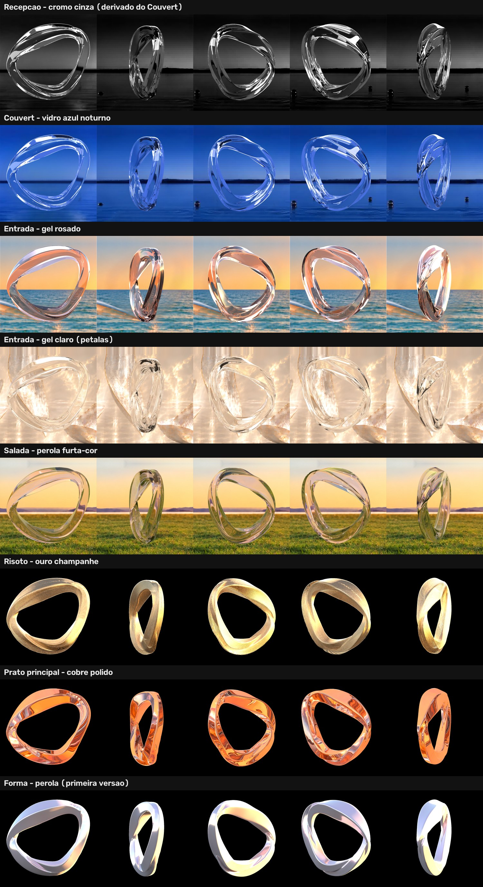

# Logo 3D: o que temos e como ele é feito

O logo é o anel de faixa ondulada da marca, que gira devagar nos vídeos de cada ato do jantar. Ele **não é gerado por IA**: vem de um modelo 3D renderizado no Blender e é colocado por cima de cada vídeo por um script.

Testamos gerar o logo no Seedance, mas o modelo deformava o anel: virava rosca oval ou "8", e o giro saía irregular. No Blender o formato fica exato, o giro é constante e a volta fecha sem emenda.

---

## 1. Arquivos

| Arquivo | O que é |
|---|---|
| [`modelo/logo-azul-liso.glb`](modelo/logo-azul-liso.glb) | **O modelo 3D do logo** (glTF 2.0, 5,4 MB), o mesmo usado em todos os renders. Para baixar, abra o arquivo e clique em *Download raw file*. |
| [`imagens/visuais-por-ato.jpg`](imagens/visuais-por-ato.jpg) | Uma volta de cada visual, ato por ato, como saiu do Blender |
| [`imagens/folha-de-referencia.jpg`](imagens/folha-de-referencia.jpg) | Folha de referência: vistas do logo e exemplos nas paredes |
| [`imagens/modelo-3d-sem-material.jpg`](imagens/modelo-3d-sem-material.jpg) | Como o `.glb` aparece ao abrir, sem material |

### Folha de referência do logo



### Como abrir o 3D

- **Windows:** dois cliques no `.glb`. Se o *Visualizador 3D* da Microsoft estiver instalado, ele abre ali, onde dá para girar e dar zoom (ele é gratuito na Microsoft Store).
- **Blender:** *File → Import → glTF 2.0 (.glb/.gltf)*.
- **Navegador:** arraste o arquivo em https://gltf-viewer.donmccurdy.com. O arquivo é aberto só no seu computador, sem envio.

O modelo vem **sem material** e aparece branco ou cinza. Cada visual da tabela abaixo (vidro, pérola, metal) é aplicado no Blender, na hora do render. Ele tem uma malha só, de cerca de 522 × 467 × 108 unidades.



---

## 2. Como o logo é feito (passo a passo)

```
modelo .glb ──► Blender: render de uma volta ──► quadros (cor + recorte)
                                                        │
vídeo do ato (Seedance / H3) ──► logo3d.py: cola o logo em cada quadro ──► vídeo final
```

### 2.1 Render no Blender

O script é `estudio/ferramentas/logo3d/blender/logo_blender.py`, rodado no Blender 5.1 com GPU (RTX 3090, OptiX).

O que ele faz:
1. Importa o `.glb`, centraliza e ajusta o tamanho: o logo ocupa 964/1254 da altura do quadro.
2. Cola os pontos soltos da malha e apaga as normais gravadas no arquivo. Sem isso, a faixa ondulada fica cheia de riscos no reflexo.
3. Aplica o material do visual (tabela 2.2) e o fundo do ato. O vidro refrata o fundo, então o mar, o céu e a grama aparecem através do logo.
4. Deforma a faixa: ela ondula de leve enquanto o anel gira.
5. Renderiza **uma volta completa** em N quadros. O quadro N seria igual ao 0, então a volta repete sem emenda.
6. Renderiza de novo, só a silhueta (`SIL=1`), para ter o recorte (alfa) de cada quadro.

Ondulação aprovada, igual em todos os visuais:

```
BLURG=1 ROLL=0 WAVE=35 NWAVE=1 BULGE=0.06 KT=1 SMOOTH=60
```

Exemplo de comando:

```bat
set BLURG=1& set ROLL=0& set WAVE=35& set NWAVE=1& set BULGE=0.06& set KT=1& set SMOOTH=60
set RES=1024& set FRAMES=480& set SAMPLES=128
blender -b -P logo_blender.py -- volta <pasta>/rgb-480
set SIL=1
blender -b -P logo_blender.py -- volta <pasta>/sil-480
```

O caminho do modelo é a variável `LOGO_GLB` ou o `logo.glb` ao lado do script.

### 2.2 Os visuais de cada ato

| Ato | Visual | Pasta dos quadros | Material no Blender (principais variáveis) |
|---|---|---|---|
| Recepção | Cromo cinza | `recepcao/rgb-484` | Sem render próprio: é o render do Couvert passado para cinza-cromo |
| Couvert | Vidro azul noturno, com o lago ao anoitecer | `couvert/rgb-484` | `COR=0.85,0.92,1 NOITE=1 IOR=1.45 ROUGH=0.02 WORLD=2.5`, 484 quadros |
| Entrada | Gel claro, sem rosa (versão pétalas) | `gel-petalas/rgb-480` | `COR=0.98,0.96,0.92 ENVIMG=gel-petalas/env.png`, fundo `gel-petalas/bg.png` |
| Entrada (antes) | Gel rosado | `gel/rgb-480` | `COR=1,0.5,0.38 TRANS=1 ROUGH=0.03` |
| Salada | Pérola translúcida furta-cor | `salada/rgb-480` | `PEROLA=1,0.9,0.95 PTRANS=0.85 METAL=0 ROUGH=0.05 FILME=750 IRIS=1.0 LUZ=0.35 WORLD=0.8` |
| Risoto | Ouro champanhe | `risoto/rgb-960` | Render de 240 quadros, interpolado com RIFE para 960 (o giro lento ficava travando) |
| Prato principal | Cobre polido | `prato/rgb-480` | Metal refletivo (`PEROLA` com `METAL=1`, ambiente do ato) |
| Sobremesa | Diamante | sem pasta | Sem render próprio: o vidro do Couvert vira diamante na montagem, com arestas em arco-íris e brilhos de estrela |

Todas essas pastas ficam em `estudio/ferramentas/logo3d/`, cada uma com o `sil-…` ao lado.



### 2.3 Montagem no vídeo (`logo3d.py`)

O script é `estudio/ferramentas/logo3d/logo3d.py`. No estúdio, ele roda pelo node **Logo 3D**.

```
python logo3d.py <preset> <entrada.mp4> <saida.mp4> '{"velocidade":0.138,"frente":true,"reflexo":0}'
```

- **Preset:** `gel`, `perola`, `salada`, `risoto`, `prato`, `couvert`, `diamante` (escolhe os quadros e a posição).
- **Posição:** no lugar da antiga Forma, no lado direito da parede de 6410 × 1150. Na Salada, por exemplo, o centro fica em x 5477 e y 416, com 731 px de altura.
- **Velocidade padrão:** `0.138`, ou seja, **uma volta a cada ~36 s**. É a velocidade da Recepção, usada em todos os atos. `1` seria uma volta a cada 5 s.
- **Ritmo visual:** de frente o anel quase não muda e de lado muda muito. O script mede isso e distribui o giro para a mudança visual ser constante, sem parecer que trava e depois pula.
- **`frente: true`:** o logo fica sempre na frente dos elementos da cena. É o padrão aprovado; a versão com o logo passando por trás foi testada e descartada.
- **`reflexo: 0`:** sem reflexo do logo na água. Foi testado no Risoto e no Prato e não ficou natural.
- **Outros ajustes:** `inicio` (de que ponto da volta começa), `tamanho` (1 = o da Forma) e `dx`/`dy` (deslocamento).

### 2.4 Ordem para um vídeo final

1. Gerar o vídeo do ato (Seedance ou MiniMax H3).
2. Deixar em câmera lenta 0,3 (node Ajuste).
3. Ampliar, se for a versão final em 6410 × 1150 (Real-ESRGAN).
4. Aplicar o Logo 3D com a velocidade 0.138, sempre por último, para o logo sair nítido no tamanho final.

---

## 3. Cuidados que aprendemos

- `ROLL=0`: rolar a faixa inteira cruzava as camadas e fazia riscos. Só a ondulação (`WAVE=35`) ficou boa.
- `YAW0=0` deixa o logo de frente no quadro 0.
- Giro lento com poucos quadros trava. Para atos muito lentos, renderize mais quadros (480 a 960) ou interpole com RIFE.
- O logo é aplicado no vídeo já ampliado e em câmera lenta. Se for aplicado antes, ele perde nitidez e muda de velocidade.
- Logo rosado não combinou com a Entrada nova, por isso ficou o gel claro.

---

## 4. Scripts

Os scripts que fazem o render e a montagem estão no repositório do estúdio: [theforcex-code/estudio-de-video](https://github.com/theforcex-code/estudio-de-video), em `ferramentas/logo3d/`. O `logo_blender.py` procura o modelo na variável `LOGO_GLB` ou num `logo.glb` ao lado dele.
